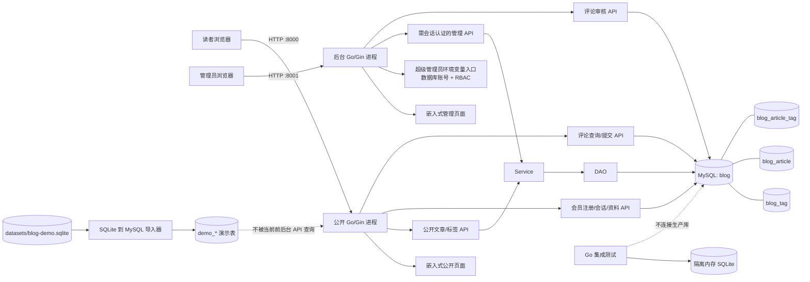
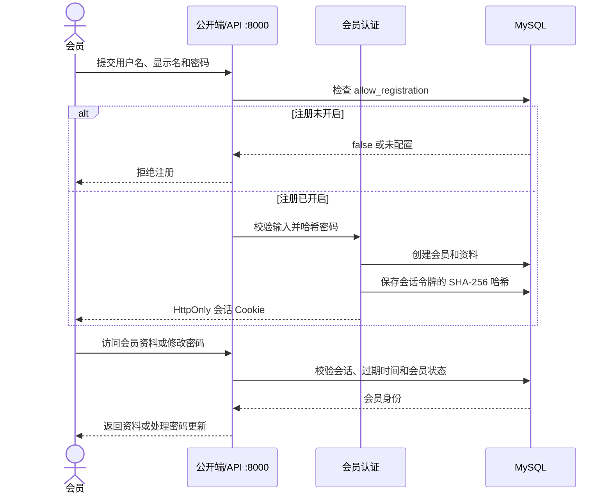
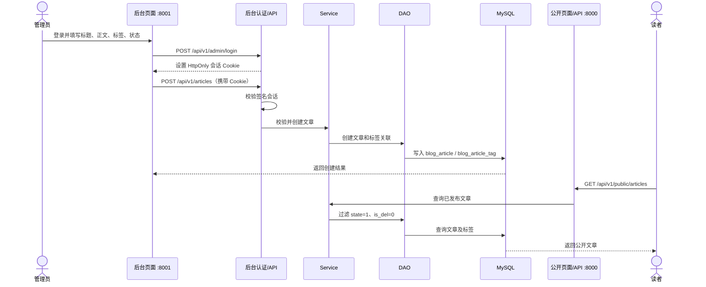
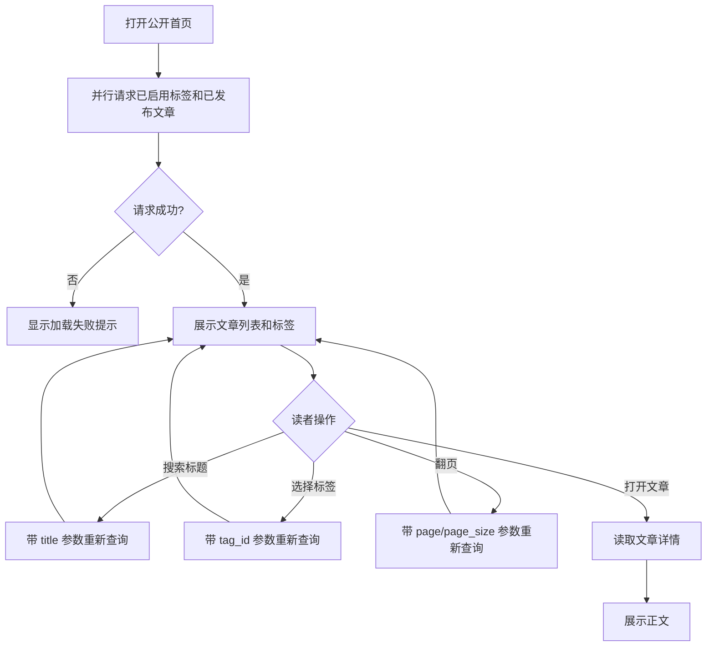
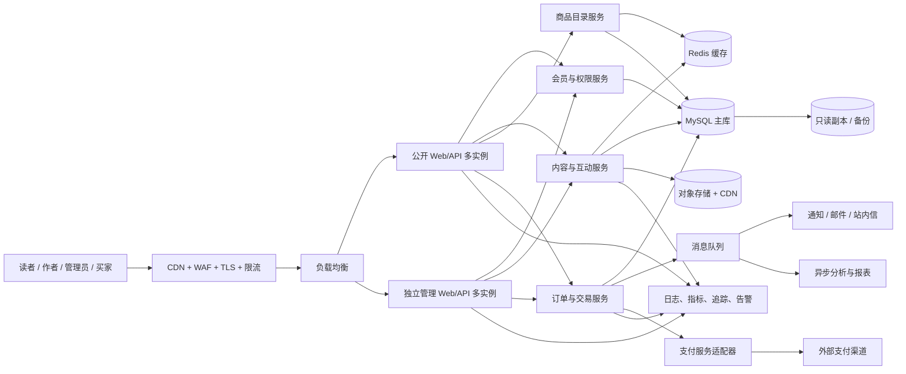

# 系统架构、业务流程与功能缺口

本文区分**当前已实现**与**建议目标架构**。图中的虚线或“规划”节点不是现有功能。

## 当前系统架构（已实现）

公开和管理服务是两个独立进程，但共享同一代码库、Service/DAO 和 MySQL 数据库。当前没有独立用户服务、缓存、消息队列、对象存储或支付系统。

## 当前会员认证流程

## 当前文章业务流程

### 管理员创建并发布文章

### 读者发现文章

## 当前已实现能力

- 公开端：已发布文章列表/详情、已启用标签列表；支持标题搜索、标签筛选和分页；会员可通过 API 注册、登录、退出、维护资料和修改密码，并能提交待审核评论。
- 管理端：环境变量超级管理员入口及数据库管理账号、角色权限、会话认证、文章/标签 CRUD、平台用户/会员管理、评论审核、配置、站点元数据和操作审计。
- 数据：文章软删除；文章关联一个标签；前后台共用 MySQL。
- 会员：独立会员账号、资料、用户名认证和服务端可撤销会话；公开注册默认关闭，会员数据尚未关联旧文章作者字段。
- 评论：登录会员可对已发布文章评论或回复；评论默认待审核，后台内容管理权限可通过或拒绝，公开接口只展示已发布文章下获批评论。
- 测试：DAO、Service、API 和管理认证可用隔离的 SQLite 测试。
- 演示集：SQLite 规范化数据可导入 MySQL 的 `demo_*` 隔离表；这些数据不自动展示在当前公开博客，也不是可登录会员或真实交易。

## 主要功能缺口

| 优先级 | 缺少能力 | 当前影响 | 建议补齐内容 |
| --- | --- | --- | --- |
| P0 | 会员/作者系统 | 已有由平台设置控制的会员注册、登录、可撤销会话、资料和公开资料 API；管理员可查询会员、停用账号和授予作者身份，但会员尚未和旧文章作者字段关联 | 邮箱验证、找回密码/安全通知、作者认证与文章作者关系 |
| P0 | 多管理员与授权 | 已有数据库管理账号、RBAC、后台写操作审计和会员状态/作者身份管理；尚无登录限速和多因素认证 | 登录限速、多因素认证、密钥轮换、审计保留/归档策略 |
| P0 | 安全与运营基础 | 尚无完整生产部署能力保证 | TLS/反向代理、配置密钥管理、备份恢复、迁移版本管理、健康检查、结构化监控告警 |
| P1 | 社区互动 | 已有评论/回复和人工审核；尚无举报、点赞/收藏、关注作者、通知和反垃圾策略 | 举报与处置流程、互动和关注、通知、速率限制与反垃圾 |
| P1 | 内容生产体验 | 仅支持基础编辑和直接发布/草稿 | Markdown/富文本编辑器、预览、草稿自动保存、定时发布、修订历史、多图上传 |
| P1 | 分类与发现 | 每篇文章最多一个标签；无推荐、热门、阅读历史 | 多标签/分类、专题、排序、相关内容、站内全文搜索 |
| P1 | 缓存和高并发 | 请求直接访问 MySQL，没有缓存、限流或扩展策略 | Redis 缓存与失效策略、限流、连接池/查询优化、负载均衡和多实例部署 |
| P2 | 商品与交易 | 当前没有商品、购物车、库存、订单或支付 | 商品/商家、SKU、库存、购物车、订单、支付回调、退款/售后、交易审计 |
| P2 | 数据与分析 | 只有文章/标签数量概览 | 阅读量、互动指标、订单报表、埋点和数据导出 |

## 面向社区和交易平台的目标架构（规划）

这是扩展方向，不代表现有代码已经按微服务拆分。早期建议仍用清晰模块化的 Go 单体/少量独立进程，先定义模块边界和 API；在容量、团队或故障隔离需求明确后再拆服务。达到“10 万在线”需要压测并定义峰值 QPS、读写比例、延迟目标和故障目标，不能仅凭增加实例或引入 Redis 保证。

## 建议实施顺序

1. **账号与权限**：会员/作者模型、认证会话、角色权限、账户安全和后台审计。
2. **社区内容闭环**：补齐举报、互动、通知、作者主页和内容修订。
3. **生产与稳定性**：图片上传、缓存策略、限流、指标/告警、备份恢复、容量压测。
4. **交易闭环**：商家和商品、库存、购物车、订单、支付幂等与退款/售后。
5. **规模化演进**：依据压测结果扩展读副本、异步队列、服务拆分与灾备能力。

每个阶段应配套 API 契约、数据库迁移、SQLite/集成测试、安全检查及可观测性，不应先把尚未实现的能力作为已上线功能宣传。
